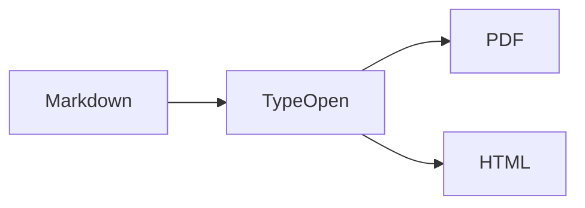

# Welcome to TypeOpen

TypeOpen keeps **Markdown** as your document format while giving you a rendered editing surface.

## Everyday Markdown

- Lists and **formatting**
- [Links](https://commonmark.org/)
- Task lists
  - [x] Open a folder
  - [ ] Write something useful

> Use Focus Mode when you want the current block to stand out, and Typewriter Mode to keep the caret near the center of the window.

| Feature | Status |
| --- | --- |
| Tables | Supported |
| Source mode | Supported |
| Export | Supported |

## Math

Inline math works with TeX such as $E = mc^2$.

$$
\int_0^1 x^2\,dx = \frac{1}{3}
$$

## Mermaid



## Sequence diagram

```sequence
Writer->TypeOpen: Edit Markdown
TypeOpen-->Writer: Live rendered document
```

## Flowchart

```flow
st=>start: Start
edit=>operation: Edit Markdown
e=>end: Export
st->edit->e
```
